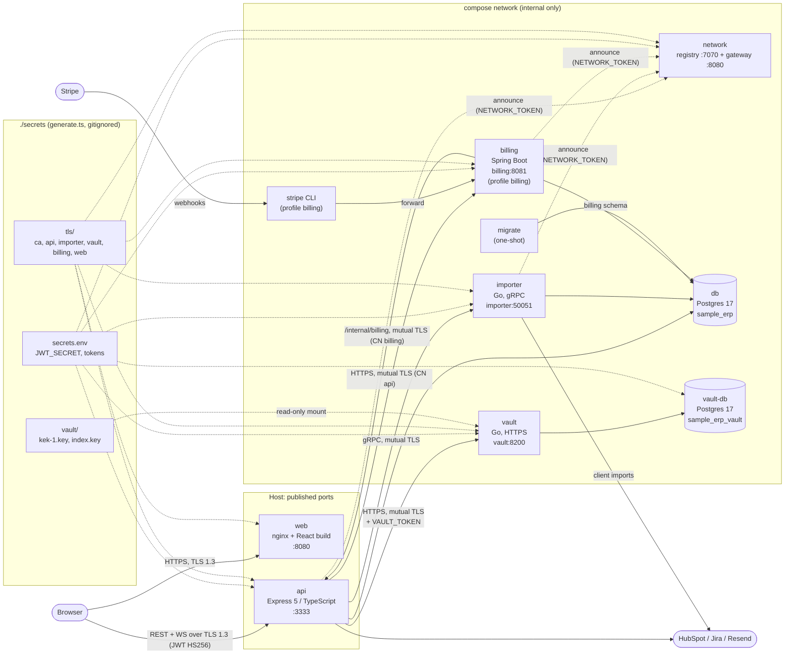
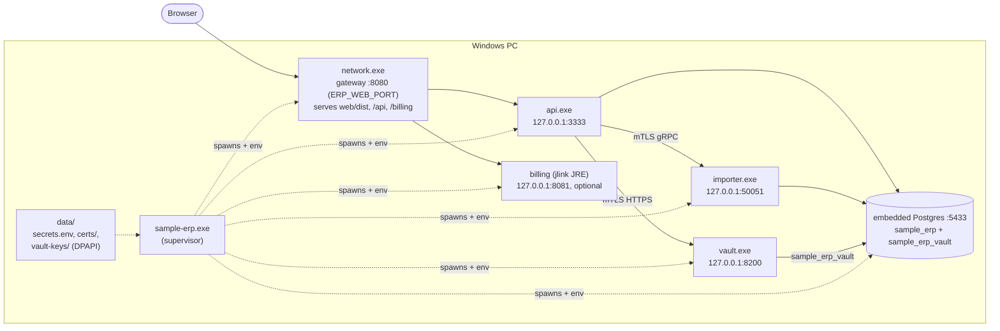

# Architecture

How the services fit together, in the two ways the stack runs: `docker compose` (Linux containers) and the
native Windows launcher (`sample-erp.exe` plus `services/*.exe`). Both have the same shape; only the
addresses and where the keys live change.

## Docker compose

Only the API (3333) and the web app (8080) are published on the host. Everything else is on the compose
network, reached by service name.

## Native launcher (Windows)

In local development, `go run ./network/cmd/network dev` gives the same shape: the network process starts `web` and `api` as children, and the API starts `importer`, `vault` and `billing` as its own (`API_CHILDREN`); logs come out in one terminal prefixed `[name]`, and Ctrl+C stops the tree from the API down (SIGTERM, then a kill after the grace period).

`sample-erp.exe` starts an embedded Postgres and supervises every service as a child process. All of them
listen on `127.0.0.1`; the network gateway is the only port a browser (or Stripe) reaches.

## Where sensitive data lives

| Data | Where | Protection |
| --- | --- | --- |
| Passwords | `usuarios.senha` | Argon2id hash |
| Usuario CPF, birth date (`YYYY-MM-DD`) | vault, `owner_type = usuario`, `owner_id = usuarios.id` | AES-256-GCM per record (random DEK) wrapped by a versioned KEK; CPF lookup through an HMAC-SHA-256 blind index |
| Integration OAuth tokens | `integracoes.*_cifrado` | AES-GCM with `INTEGRATIONS_ENCRYPTION_KEY` (next to move into the vault) |
| Client e-mail / phone | HubSpot (read live), `clientes` cache | next to move into the vault |
| Service tokens | `secrets/secrets.env` / `data/secrets.env` | the receiving side compares SHA-256 digests in constant time |
| Vault KEK + index key | `secrets/vault/` (compose) or `data/vault-keys/` (launcher) | file mode 0600; on Windows DPAPI-encrypted for the current user |

The vault and the ERP database are linked only logically: a vault record's `owner_id` is the ERP row's id.
The API writes the ERP row first, then the vault record, and removes the row if the vault refuses it.
